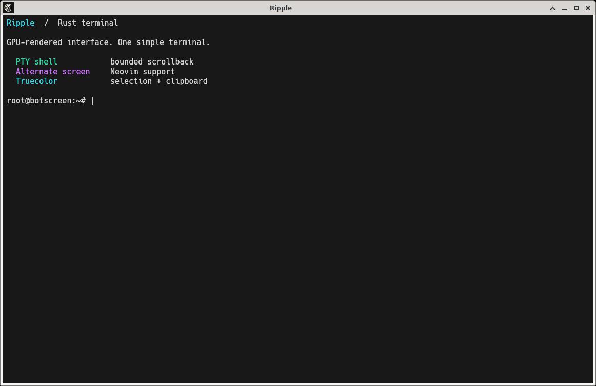

# Ripple

A Rust terminal emulator with a GPU-rendered interface and a simple workflow.



## Download

Get the Linux x86_64 build from [GitHub Releases](https://github.com/BLig-Vox/Ripple/releases). Version 0.1.0 is an early prerelease. The binary is built on Ubuntu 24.04 and requires glibc 2.39 or newer, an X11 or Wayland desktop, and a working Vulkan or EGL/OpenGL graphics driver. Other Linux distributions have not been verified.

```sh
sha256sum -c SHA256SUMS
tar -xzf ripple-v0.1.0-linux-x86_64.tar.gz
cd ripple-v0.1.0-linux-x86_64
./ripple
```

To put the binary on your PATH:

```sh
install -Dm755 ripple "$HOME/.local/bin/ripple"
```

For application menu and desktop integration, use the source installer below.

## Current state

The first Linux prototype uses `eframe` with its wgpu renderer and a custom wgpu pass for cell backgrounds and the cursor. It launches the default shell through a PTY, parses a starter ANSI/VT subset, and provides bounded scrollback, drag selection, and clipboard shortcuts. It opens at 80% of the active monitor's dimensions and centers itself on that monitor.

This is an early prototype, not yet a feature-complete terminal. Current limitations include single-window operation, incomplete VT compatibility, no shaped GPU glyph atlas, and no advanced terminal graphics protocols.

## Arch Linux packaging

The source package recipe is in [packaging/arch](packaging/arch/README.md).
An Arch-built `vox-ripple` package and checksum are available on the
[v0.1.0 release](https://github.com/BLig-Vox/Ripple/releases/tag/v0.1.0).
It has **not been published to the AUR yet**; new account registration is temporarily closed.

## Cargo installation

With Rust 1.95 or newer and the Linux graphics dependencies installed:

```sh
cargo install vox-ripple --locked
ripple
```

Cargo installs the `ripple` executable into `~/.cargo/bin` by default. Ensure that
directory is on your PATH. Cargo does not install desktop shortcuts or system
libraries. For desktop integration, clone this repository and run the source
installer below.

For installation directly from the existing GitHub release:

```sh
cargo install --git https://github.com/BLig-Vox/Ripple --tag v0.1.0 --locked --bin ripple
```

## Build and run

Install a recent stable Rust toolchain and the Linux development libraries required by winit/wgpu. Then run:

```sh
cargo run --release
```

The window uses wgpu through eframe. Vulkan or a supported desktop graphics backend must be available.

## Appearance and shortcuts

Ripple opens as one plain terminal surface with a native title bar and 8 pixels of padding. There are no permanent toolbars or status badges. Drag to select text, use Ctrl+Shift+C to copy, Ctrl+Shift+V to paste, and the mouse wheel for scrollback.

## Memory and session lifecycle

PTY output uses a bounded 32-chunk queue (8 KiB per chunk). Scrollback is limited to 2,000 lines and 8 MiB of retained cell storage, whichever is reached first. The visible grid is limited to 512 columns and 256 rows. GPU vertex buffers grow only to the visible grid's needs and are owned by the renderer.

Session shutdown cancels the reader, joins its thread, and terminates and reaps the shell. Reader waits and queue sends check cancellation every 50 ms. Regression tests repeatedly open and close sessions with both idle and saturated output and check child processes, thread counts, and file descriptors.

```sh
cargo test -- --test-threads=1
python3 scripts/memory-soak.py <ripple-pid> 60
```

The sampler reports Linux RSS, thread counts, and descriptor counts. RSS includes graphics-driver caches and allocator retention; a short stable run does not prove the absence of every possible leak.

## Desktop launcher

Run `./scripts/install-desktop.sh` to build a release binary and install Ripple for the current user. The installer adds an application menu entry, a desktop shortcut, and the logo. Use `--debug` for a development build. Rust, Python 3, and the Linux build prerequisites above must be installed.

## Full-screen applications

Ripple recognizes the alternate-screen sequences used by Neovim (`?1049h` / `?1049l`). The shell screen is restored on exit, and alternate-screen output never enters shell scrollback. Scrolling regions, reverse index, line insertion/deletion, cursor visibility, application cursor keys, basic terminal replies, truecolor, and bracketed paste are supported. Wheel events go to applications that enable mouse reporting; otherwise alternate-screen wheel input sends cursor keys. This remains a limited VT implementation.

## License

Ripple is licensed under the [MIT License](LICENSE.md).
