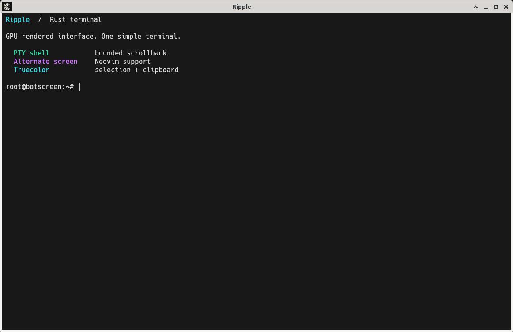

# Ripple v0.1.0

First Linux prerelease of Ripple, a Rust terminal emulator with a GPU-rendered interface.

## Included

- Plain terminal surface with a native title bar, centered at 80% of the monitor.
- PTY shell, ANSI colors and truecolor, bounded scrollback, and resize support.
- Selection, Ctrl+Shift+C copy, Ctrl+Shift+V paste, and Ctrl+C interrupts.
- Alternate screen and scrolling regions for applications such as Neovim.
- Application icon and a source installer for desktop integration.



## Download and run

Download the Linux x86_64 archive and SHA256SUMS from this release. Verify and extract:

```sh
sha256sum -c SHA256SUMS
tar -xzf ripple-v0.1.0-linux-x86_64.tar.gz
cd ripple-v0.1.0-linux-x86_64
./ripple
```

Built on Ubuntu 24.04; requires glibc 2.39 or newer, an X11 or Wayland desktop, and a Vulkan or EGL/OpenGL graphics driver. Other Linux distributions have not been verified. The archive includes the binary, README, license, desktop entry, and logo. Build from source with `cargo build --release --locked` if your system is incompatible.

## Arch Linux package

Download `vox-ripple-0.1.0-1-x86_64.pkg.tar.zst` and its matching `.sha256`
file from this release, then run in the download directory:

```sh
sha256sum -c vox-ripple-0.1.0-1-x86_64.pkg.tar.zst.sha256
sudo pacman -U ./vox-ripple-0.1.0-1-x86_64.pkg.tar.zst
```

This package was built from the tagged source in an Arch Linux container.
It installs the `ripple` command, application menu entry, icon, and MIT license.
The [Arch package build](https://github.com/BLig-Vox/Ripple/actions/runs/43752946785)
passed; graphical operation on an Arch desktop has not been verified.
AUR publication is pending because new account registration is temporarily closed.

## Known limitations

This is an early prototype with incomplete VT compatibility, one terminal per window, no shaped GPU glyph atlas, and no advanced graphics protocols. Hardware acceleration depends on the host graphics driver. Memory queues and scrollback are bounded; previous short memory soak runs do not prove the absence of every possible leak.
